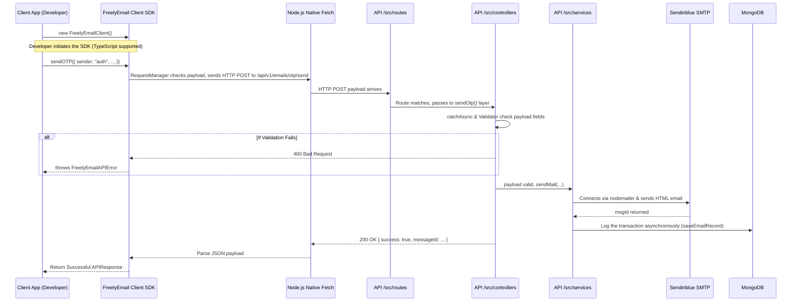

<div align="center">
  <h1>freelyEmail 🤖 ✉️ by Harshit</h1>
  <p>A simple, powerful, and scalable email-sending SDK native for Node.js, built with ❤️ by <strong>Harshit Keshari (<a href="https://github.com/Harshit107">Harshit107</a>)</strong>. Connects effortlessly to the <a href="https://github.com/Harshit107/FreelyEmail-API">FreelyEmail-API</a>.</p>
</div>


**Version Requirement**: Node.js `>= 18.0.0` (Uses native fetch, 0 dependencies).

## ✨ Architecture Flow Diagram



## 🚀 Features
- **Created by Harshit**: Maintainable open-source library explicitly crafted by Harshit107.
- **Object-Oriented Design**: Instantiate the `FreelyEmailClient` and go.
- **Robust Error Handling**: Distinct Custom Errors (`FreelyEmailAPIError`) for robust backend integrations.
- **TypeScript Support**: Full code-completion and Type definitions included out-of-the-box.
- **No Dependencies**: Relies completely on native Node.js fetch APIs!

---

## 📥 Installation

```bash
npm install freely-email
```

---

## 🛠 Basic Setup

Import and initialize the client. You can optionally pass a custom `baseURL` if you host the associated API yourself.

```javascript
const { FreelyEmailClient } = require("freely-email");

// Default public API
const emailClient = new FreelyEmailClient(); 

// OR Custom Private API Server
// const emailClient = new FreelyEmailClient({ baseURL: "https://my-custom-email-api.com/api/v1/emails/" });
```

---

## 📖 Usage Examples

### 1. Send Normal Notification Email 📝
Send a customized email with optional HTML attachments.

> **Tip on Parameters**: The SDK seamlessly supports both property naming conventions (`to` or `recipient`, `app` or `appName`, `text` or `message`, `html` or `HTMLfile`).

```javascript
async function notifyUser() {
  try {
    const response = await emailClient.sendEmail({
      to: "user@example.com",
      appName: "My Demo App",
      subject: "Welcome Aboard!",
      text: "This is a clean notification message.",
      // HTML is optional; if omitted, the API renders a beautiful modern card template automatically!
    });
    console.log("Success:", response.message, "ID:", response.data.messageId);
  } catch (error) {
    console.error("Failed to send email:", error.message);
  }
}
notifyUser();
```

### 2. Request OTP (Auto-Generated) 🔐
Ask the API to securely generate a 6-digit OTP and email it to the user with a beautiful, modern HTML template.

```javascript
async function requestOTP() {
  const result = await emailClient.requestOTP({
    sender: "Example Auth",
    recipient: "user@example.com",
    app: "Demo App",
    subject: "Your Login Code",
    withValidTime: 10 // Validity displayed as 10 minutes in the UI
  });
  console.log("OTP Sent!", result.message, "Message ID:", result.data.messageId, "OTP:", result.data.otp);
}
```

### 3. Send Custom OTP 🔢
Send your own pre-generated OTP code to the recipient.

```javascript
async function sendCustomOTP() {
  const result = await emailClient.sendOTP({
    sender: "Security Team",
    recipient: "user@example.com",
    otp: "849201",
    withValidTime: 5
  });
  console.log("Custom OTP dispatched:", result.data.messageId);
}
```

### 4. Send Magic Link / Verification Link 🔗
Send an email containing a secure verification or action link.

```javascript
async function sendLink() {
  const result = await emailClient.sendLink({
    sender: "Verify Service",
    recipient: "user@example.com",
    link: "https://myapp.com/verify?token=xyz123",
    subject: "Verify your email address",
    buttonText: "Confirm Account",
    withValidTime: 15
  });
  console.log("Link sent:", result.data.messageId);
}
```

### 5. Send Check Health 🩺
Ping the backend server to ensure the email API is online.

```javascript
emailClient.checkHealth()
  .then(res => console.log(res.message, res.data))
  .catch(err => console.error("API is down:", err));
```

---

## 🏛️ Centralized Constants & Endpoints

The SDK exports constants so consumers never need to hardcode API URLs, routes, success messages, or error strings:

```javascript
const {
  DEFAULT_BASE_URL,
  API_ENDPOINTS,
  SUCCESS_MESSAGES,
  ERROR_CODES,
  ERROR_MESSAGES,
} = require("freely-email");

console.log("Default Base URL:", DEFAULT_BASE_URL);
// https://email.api.harshit107.in/api/v1/emails/

console.log("Endpoints:", API_ENDPOINTS.SEND, API_ENDPOINTS.HEALTH);
// send ../health

console.log("Success messages:", SUCCESS_MESSAGES.EMAIL_SENT);
// Email dispatched successfully
```

---

## ✨ Standardized Success Returns (`APIResponse`)

All successful SDK methods resolve an `APIResponse` object with an identical structure:

```typescript
interface APIResponse<T = any> {
  success: boolean;   // Always true on resolved promises
  data: T;            // Payload (e.g., { messageId, otp? })
  message?: string;   // Human-readable success message
  error: null;        // Always null on success
}
```

Example return:
```json
{
  "success": true,
  "data": {
    "messageId": "msg_01HXYZ987654"
  },
  "message": "Email dispatched successfully",
  "error": null
}
```

---

## 🛡️ Unified Error Handling

Both API and SDK-side errors follow a structured format with `errorCode`, `message`, and optional `details`:


```json
{
  "errorCode": "VALIDATION_ERROR",
  "message": "Sender is required, A valid recipient email address is required"
}
```

The SDK provides two custom error classes:
- **`FreelyEmailAPIError`**: Thrown when the remote API returns an HTTP error (`status >= 400`) or a network failure occurs.
  - `err.status`: HTTP status code (e.g., `400`, `429`, `500`)
  - `err.errorCode`: Standard error code (e.g., `RATE_LIMIT_EXCEEDED`, `VALIDATION_ERROR`)
  - `err.message`: Human-readable error message
  - `err.error`: Structured `{ errorCode, message, details }` object
  - `err.details`: Optional contextual details
- **`FreelyEmailValidationError`**: Thrown before any network request if client-side parameters are invalid (e.g., non-string `baseURL`, non-object payload).

### Comprehensive Catch Example:

```javascript
const {
  FreelyEmailClient,
  FreelyEmailAPIError,
  FreelyEmailValidationError,
  ERROR_CODES,
} = require("freely-email");

const client = new FreelyEmailClient();

try {
  await client.sendEmail({
    sender: "support-bot",
    recipient: "user@example.com",
    app: "My App",
    subject: "Hello World",
    message: "Welcome to our application!"
  });
} catch (err) {
  if (err instanceof FreelyEmailValidationError) {
    console.error(`[Client Validation] (${err.errorCode}):`, err.message);
  } else if (err instanceof FreelyEmailAPIError) {
    console.error(`[API Error] Status ${err.status} [${err.errorCode}]:`, err.message);

    switch (err.errorCode) {
      case ERROR_CODES.RATE_LIMIT_EXCEEDED:
        console.warn("Rate limited. Please back off before retrying.");
        break;
      case ERROR_CODES.VALIDATION_ERROR:
      case ERROR_CODES.MISSING_EMAIL_CONTENT:
        console.warn("Please fix request parameters:", err.details);
        break;
      default:
        console.error("Server or dispatch error:", err.message);
    }
  } else {
    console.error("Unexpected error:", err);
  }
}
```

